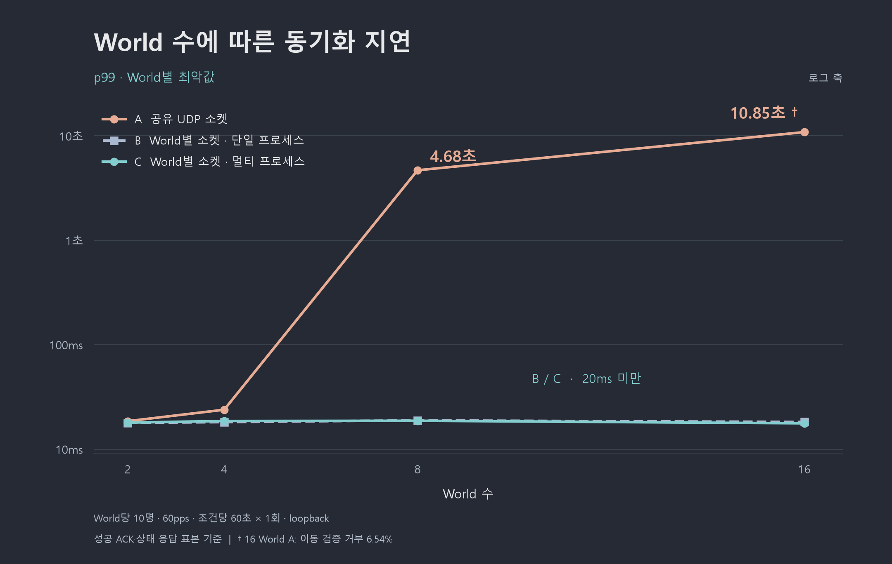

> 본 글은 [FPS 서버 연구 프로젝트](https://github.thejaeu.com/fps-reverse-planning-server-research)의 Dedicated Server 선택 이유에 관한 보고서 형식의 실험 노트입니다.

## 배경

- 서버의 처리 지연과 관련하여 이전의 [Lockstep 동기화 연구 프로젝트](https://github.thejaeu.com/server-research)의 방식인 공유 I/O (UDP 소켓)의 문제를 해결해야 할 상황이었다.
    - 기존 구조는 수신한 Udp 패킷을 LockstepGroup으로 전달
- 정확한 문제점은 다음과 같다
    1. UDP 소켓이 프로세스에 유일하게 존재하여 모든 UDP 통신의 In/Outbound를 담당하여 처리
    2. 한 프로세스에 수많은 요청이 몰리면 처리 지연이 폭발적으로 증가

## 문제에 대한 가설 수립 및 실험 준비

### 가설 1

- UDP 소켓을 각 World 마다 따로 배정하면 처리 지연이 해소된다

### 가설 2

- 멀티 프로세스로 서버를 구성하면 UDP 소켓 또한 격리되어 처리 지연을 해소할 수 있다

### 실험 준비

- Codex를 통해 가설에 대한 내용을 전달 및 테스트 코드 작성 요청(각각 A, B, C 군으로 분류)
    - A : 단일 소켓 다중 World 구조
    - B : World 당 소켓 배정
    - C : World 프로세스 격리 (멀티 프로세스) 구조
- World 의 수를 늘려가며 측정할 수 있도록 지시 (2, 4, 8, 16 world)
- 표본을 정확하게 얻기 위해 10분 이상의 데이터 측정

## 테스트 코드 실행

- AI 가 작성한 테스트 코드를 통해 **약 17분**의 측정
- A, B, C 군에 대한 **world 증가 테스트** 수행

## 결과

### A - 공유 I/O

- **가설 1** 과 **동일하게** World가 증가할 수록 폭발적인 처리 지연 발생
- 16개의 world 실험에서 **최악 10.85초** 측정
- B, C와 극단적인 차이를 보임

### B - 분리 I/O (단일 프로세스)

- **가설 1** 과 **동일하게** World 당 소켓을 통한 처리 지연 해소
- 16개의 world 까지 한 tick 내에 처리가 가능한 **20ms** 수준의 지연 측정

### C - 분리 I/O (멀티 프로세스)

- **가설 2**와 **다르게** 멀티 프로세스 구조가 문제를 해결 할 만큼 비교군 B와 차이가 없음
- B와 비교했을 때 그래프 상으로는 **동일**하다고 판단

## 결론

- 공유 I/O를 분리하여 각 World 별로 소켓을 따로 지정했을 때 확연한 지연 감소 효과를 볼 수 있었음
- B와 C의 비교를 통해 멀티 프로세스가 처리 지연을 해소하는 Key는 아님을 확인함

## 결론에 따른 아키텍처 개선 방향

- 공유 I/O를 분리하되 멀티 스레드 보다는 멀티 프로세스로 결정
    - 이유는 World의 격리를 위함

## World 격리

- 앞선 실험의 결과로 World 당 I/O 분리가 타당하다는 것을 확인했음
- 그러나 남은 과제가 존재
    - World 가 3개가 있다고 가정할 때, world 2에 문제가 생겼을 때 오류가 전파되어 다른 world에 영향을 줄 수 있음
    - 치명적인 오류라면 전체 world가 shutdown 되는 상황 발생
    - 서버의 목적 상 각 world가 서로 상호작용하지 않는 독립된 객체
- 종합적으로 판단했을 때 world를 프로세스 단위로 격리하여 특정 world의 문제를 다른 world로 전달하지 않으며 각각의 고유한 메모리를 소유하는 구조로 설계하는것이 타당하다고 판단함

## 최종 정리

- 기존의 [Lockstep 동기화 연구 프로젝트](https://github.thejaeu.com/server-research)의 구조는 소켓 소유권과 통신 구조의 단순화를 이유로 서버 공용 UDP 를 선택하여 LockstepGroup에 패킷을 전달하는 방식을 선택했으나 이번 [FPS 서버 연구 프로젝트](https://github.thejaeu.com/fps-reverse-planning-server-research)의 서버 구조에서는 적절하지 못한 구조라는 것을 파악함
- 각 비교군 실험을 통해 멀티 프로세스라는 적절한 구조 개선을 수행 할 수 있었음
- AI 의 빠른 코드 작성과 분석 능력 덕분에 직접 테스트 하는 것 보다 빠른 결과물을 산출할 수 있었음
